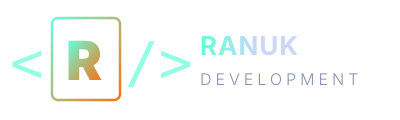
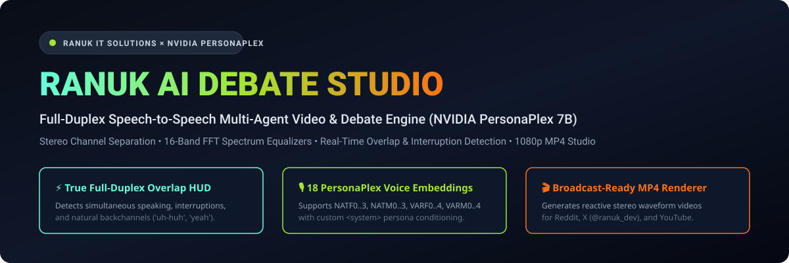
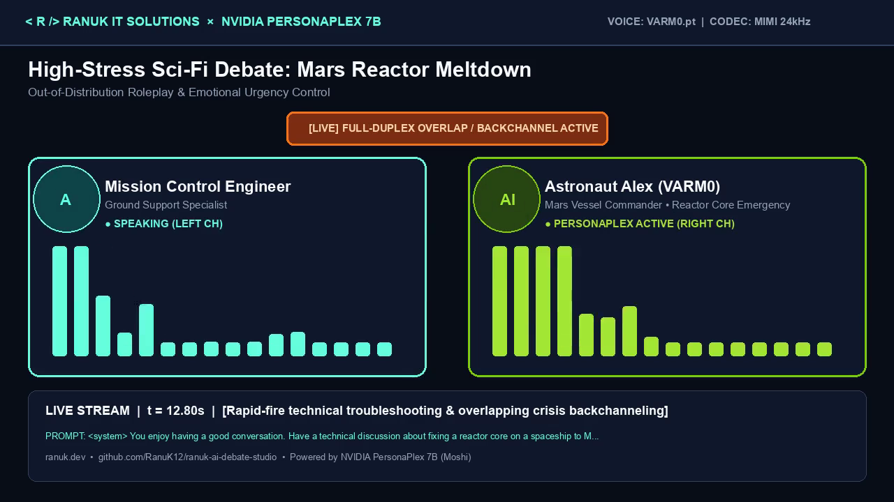
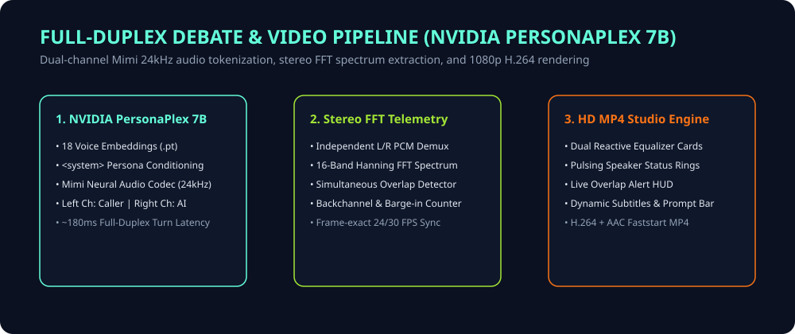

<div align="center">



# Ranuk AI Debate Studio
### Full-Duplex Multi-Agent Debate & Broadcast Video Engine powered by NVIDIA PersonaPlex 7B

[](pyproject.toml)
[-76b900.svg?style=for-the-badge&logo=nvidia)](https://github.com/NVIDIA/personaplex)
[](ranuk_debate_studio/waveform_analyzer.py)
[](LICENSE)

<br/>



</div>

---

## 🌟 Executive Overview

**Ranuk AI Debate Studio** transforms raw full-duplex speech-to-speech conversations from **NVIDIA PersonaPlex (`nvidia/personaplex-7b-v1` / Kyutai Moshi)** into broadcast-grade, high-retention 720p/1080p MP4 videos ready for Reddit, X (`@ranuk_dev`), YouTube, and B2B product showcases.

Unlike sequential Text-to-Speech (TTS) podcast generators where speakers wait politely in robotic silence, **PersonaPlex** listens and speaks simultaneously on independent stereo channels (`Left Channel = Interlocutor / Agent A`, `Right Channel = PersonaPlex 7B / Agent B`), producing organic interruptions, contextual backchannels (*"uh-huh"*, *"yeah"*, *"right"*), and emotional urgency.

**Ranuk AI Debate Studio** demuxes both channels at 24 kHz, computes independent 16-band Hanning FFT frequency spectrums per frame, detects exact full-duplex overlap events, and renders synchronized dual-equalizer videos with live telemetry HUDs.

---

## 📸 Rendered Broadcast Frame Preview

<div align="center">
  
  <p><em>Actual frame rendered from <code>mars_reactor_crisis.mp4</code> at <code>t = 12.80s</code> showing simultaneous Left &amp; Right channel vocalization and the live Full-Duplex Overlap alert HUD.</em></p>
</div>

---

## 🏛️ Pipeline Architecture

<div align="center">
  
</div>

---

## ⚡ Core Capabilities

1. **18 Native PersonaPlex Voice Embeddings**:
   - **Natural Female**: `NATF0.pt`, `NATF1.pt`, `NATF2.pt`, `NATF3.pt`
   - **Natural Male**: `NATM0.pt`, `NATM1.pt`, `NATM2.pt`, `NATM3.pt`
   - **Variety Female**: `VARF0.pt`, `VARF1.pt`, `VARF2.pt`, `VARF3.pt`, `VARF4.pt`
   - **Variety Male**: `VARM0.pt`, `VARM1.pt`, `VARM2.pt`, `VARM3.pt`, `VARM4.pt`
2. **Idempotent `<system>` Role Conditioning**:
   - Automatically formats role prompts into `<system> ... <system>` tags for `python -m moshi.offline` and `python -m moshi.server`.
3. **Stereo Full-Duplex Overlap & Barge-In Telemetry**:
   - Frame-accurate RMS and 16-band FFT spectrum decomposition per channel.
   - Highlights exact moments where the caller interrupts PersonaPlex or PersonaPlex emits active-listening backchannels.
4. **Zero-Dependency FFmpeg Rawvideo Pipe**:
   - Renders crisp 1280×720 / 1920×1080 H.264 + AAC (`+faststart`) MP4 videos at >60 FPS encoding speed.

---

## 🚀 Quickstart

```bash
git clone https://github.com/RanuK12/ranuk-ai-debate-studio.git
cd ranuk-ai-debate-studio
pip install -e .
```

### Render a Full-Duplex Debate Video
```python
from pathlib import Path
from ranuk_debate_studio import PRESET_SCENARIOS, render_debate_video

scenario = PRESET_SCENARIOS["mars_reactor_crisis"]
render_debate_video(
    scenario=scenario,
    audio_path=Path("assets/samples/astronaut.mp3"),
    output_mp4=Path("outputs/mars_reactor_crisis.mp4"),
    fps=24,
    max_duration_sec=24.0,
)
```

---

## 🧪 Testing

```bash
pytest tests/ -v
```

---

## 🏢 Enterprise Licensing & Contact

Built by **Ranuk IT Solutions** ([https://ranuk.dev](https://ranuk.dev)).
- **Email**: [contact@ranuk.dev](mailto:contact@ranuk.dev)
- **Lead Architect**: Emilio Ranucoli ([emilio@ranuk.dev](mailto:emilio@ranuk.dev))
